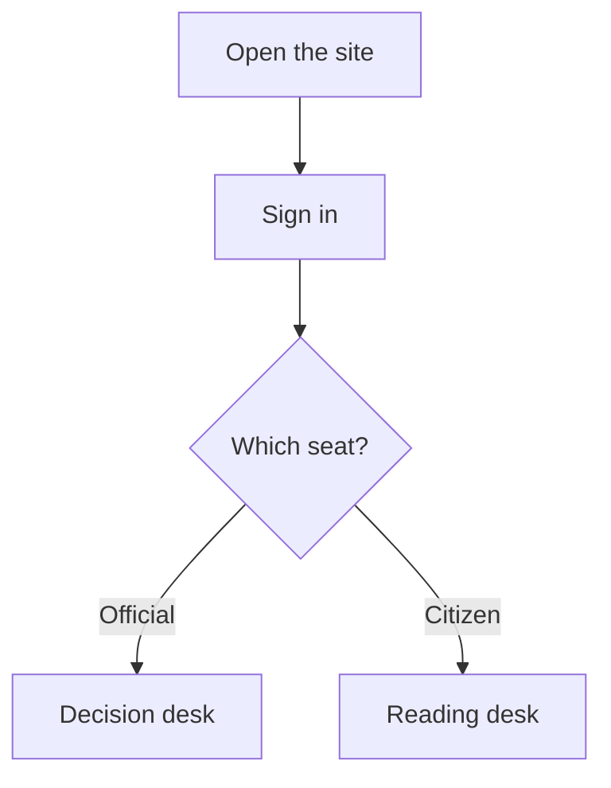
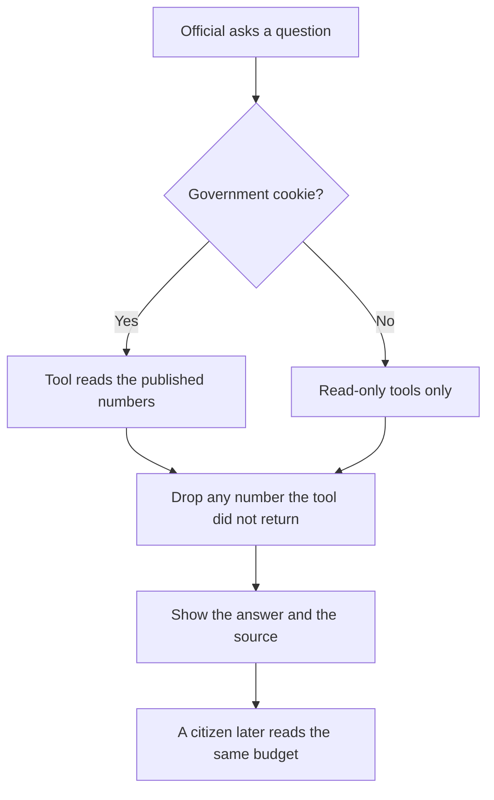

# How NationOS works

This note is for teammates who need to explain the app. The sentences are short on purpose.

## NationOS in one minute

NationOS is a website about public money in Lagos State.
A citizen can read the published budget and revenue in plain language.
A government official can ask questions and try a what-if before anyone calls it a decision.
Every figure names the office that published it.
If we do not have a number, the site says so.

## The two desks

**What it is.** After sign-in, each person lands on one desk. There are only two.

**What it does.** A government official opens `/dashboard/government`. That desk shows the published Lagos figures and a what-if tool. A citizen opens `/dashboard/citizen`. That desk shows the same published figures and does not let anyone change them.

**Why it matters.** The public can see the numbers. Officials can test an idea. A new account is always a citizen. The sign-up form cannot create a government seat.

The two demo sign-ins are in the [README](README.md).

## Sign-in

**What it is.** One page, `/sign-in`, for both seats. A cookie is a small signed note the browser sends back. The note already says who you are, which seat you have, and when it expires. It lasts 12 hours.

**What it does.** The person types an email and a password. The server checks the password. It then sets the cookie and sends the browser straight to the right desk. The button waits at most 15 seconds, then says so. Later pages trust that note after they check the signature. They do not look up a saved visit. Sign out throws the cookie away.

**Why it matters.** The browser does not get to pick the role. A citizen who opens the government desk, the plan page, or the what-if page is sent to a short “not for this seat” page. The two demo people are written in the program, so signing in as them does not save a file. A copied cookie keeps working until it expires. That is the trade for not keeping a visit list on the server.

## The numbers

**What it is.** A database is a file that holds saved numbers. This app keeps three of them. One holds the Nigeria figures. One holds the 2026 figures copied from the `main` branch. One holds accounts.

**What it does.** The first time a file is needed, the app creates it and fills the starter rows. The Lagos money on the desks is published internally generated revenue. That means money the state collected itself. It is not money sent by the federal government, and it is not the whole Lagos budget.

**Why it matters.** The site does not invent a tax rate or a Lagos spending plan. The federal number on the page is a national headline. The what-if tool does not spend it.

## Asking a question

**What it is.** Both desks have an advisor. It can use Grok, a language model reached through Vercel’s AI Gateway. A gateway here is a door that talks to the model for us. If that door is closed, the same box uses fixed rules that read the database.

**What it does.** The model must call a tool before it states a figure. A tool is a small server function that reads one published table or runs one labelled what-if. After the reply, the server checks every number. A number that was not in the tool result is removed. The badge says which path answered: AI with figures checked, AI with a figure removed, or rule-based.

**Why it matters.** A fluent sentence is not evidence. The government seat may run a what-if. The citizen seat can only read. A visitor with no cookie is treated as read-only. A question sent in the older `{ "query" }` shape never goes to the model.

## One real visit

Adaeze works on the Lagos budget. She opens the site and signs in on the government seat.

She sees the published Lagos revenue, the tax part, and the other part, with the publisher named. She asks, “What if Lagos tax collections were 10% lower than the published figure?”

The server reads her cookie and sees that she is government. If Grok is available, the model calls the what-if tool. The tool reads the published tax amount and applies 10%. The reply comes back only after the number check. The screen says it is a projection. A projection is a what-if sum. It is not a new tax law, and it does not promise jobs or services.

If no AI key is set, she still gets an answer. The badge says rule-based. The figures still come from the database.

Later, Chinedu, a resident, signs in on the citizen seat. He sees the same published Lagos revenue in plain language, with the same source. He does not see the slider. He can ask where the money comes from. His advisor cannot run the what-if. If he opens the plan page, the site turns him away.

## The pages, in plain words

| Address                             | Who                  | What you see                                           |
| ----------------------------------- | -------------------- | ------------------------------------------------------ |
| `/`                                 | Anyone               | What the site is, and a sign-in button                 |
| `/sign-in`                          | Anyone not signed in | Sign in, or create a citizen account                   |
| `/dashboard/government`             | Government only      | Published figures, a what-if, and the advisor          |
| `/dashboard/citizen`                | Citizen only         | The same figures, read only                            |
| `/overview`, `/revenue`, `/sources` | Any signed-in person | The wider picture, state revenue, and who published it |
| `/budget`, `/scenarios`             | Government only      | Ask the data, then draft a plan and compare cases      |
| `/decisions`                        | Any signed-in person | Saved reasons. Only government can change a status     |

The green bar uses the NationOS logo. The landing page, the sign-in page, and the desk share that logo.

## What the server answers

An API is a web address the page calls when it needs the server to do the work. The page and these addresses live in the `frontend` folder. There is no second program to start.

Sign-in, sign-up, sign-out, and “who am I” each have their own address under `/api/auth`. Sign-up refuses anything except a citizen.

Reading addresses return the overview, revenue, sources, and saved decisions. Writing addresses save a plan, a split, a scenario, or a decision. Those writes are for the government seat only.

`/api/chat` answers a `{ "message" }` or `{ "question" }` question. With no AI key, the answer is rule-based. With a key, Grok answers through the tools, then the number check runs. `stream: true` sends that checked text in pieces. A `{ "query" }` body returns the short ledger answer from `main` and does not call the model. The answer includes `aiStatus` so the badge can say the AI is working, not configured, or failed.

The older money addresses from `main` stay as they were: overview, revenue, a budget recommendation, scenarios, a split, and decisions. Their sentences stay the same.

The server limits how many questions one visit can ask. It does not write passwords or keys into the log.

## On Vercel

**What it is.** Vercel hosts the site. The project folder to deploy is `frontend`. The server disk there cannot be changed.

**What it does.** Published money is read from a file built when the site is deployed. That file is not written at run time, and it is not copied into `/tmp`. Sign-in does not use that file. The cookie is enough. New accounts, saved plans, and decisions go to Neon when `DATABASE_URL` is set. The tables are created the first time someone needs them. With no database address, saving returns a clear error and nothing is kept on the computer. The two demo sign-ins still work. Your own computer needs `DATABASE_URL` too.

**Why it matters.** A decision saved by an official is visible to a citizen on any copy of the site, because they read the same Neon database. A saved decision no longer disappears when one copy of the server stops.

On Vercel you do not paste an AI key. Turn on OIDC under Project Settings → Security. Vercel then sends a short-lived pass on each request, in the `x-vercel-oidc-token` header. That pass lets the AI Gateway call Grok. It is not an environment variable you add. If OIDC is off, set `AI_GATEWAY_API_KEY` from the team AI Gateway page instead. The badge says when the answer stayed rule-based. The server log records the reason and leaves out keys. Locally, use a gateway key, or run `vercel env pull`, or use a direct xAI key. The names are in `frontend/.env.example`. The steps are in the frontend README.

## How to explain this to judges

NationOS lets the public read published Lagos revenue, and lets an official test a change before it is treated as a decision.

The figures come from named publishers. Missing numbers stay missing. A what-if is labelled as a projection.

The advisor may use Grok. It can only repeat numbers a tool just read. Any other number is removed. With no key, the same questions still get a rule-based answer.

There are two seats. The public seat cannot run the what-if or open the plan page. A new account cannot become a government seat.

The app deploys as one Next.js site. The demo sign-ins work on Vercel because those accounts are part of the program, and the cookie does not need a saved visit.

## Words we use

| Word       | Plain meaning                                                           |
| ---------- | ----------------------------------------------------------------------- |
| Cookie     | A signed note that says who you are and which seat you have             |
| Session    | That signed-in visit. It lives in the cookie, not in a database row     |
| Role       | Government official, or citizen                                         |
| Database   | A file that holds the saved numbers                                     |
| API        | A web address the page calls so the server can do the work              |
| IGR        | Money a state collects itself, not money sent by the federal government |
| Projection | A what-if sum. Not a law, and not a promise                             |
| Tool       | A server function the model must call before it states a figure         |
| AI Gateway | Vercel’s door to Grok. On Vercel it signs in by itself                  |
| OIDC token | The short-lived pass Vercel gives the app for that door                 |
| `/tmp`     | Scratch space on the server. Files there do not last                    |
